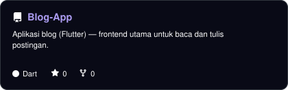
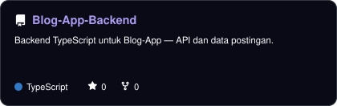
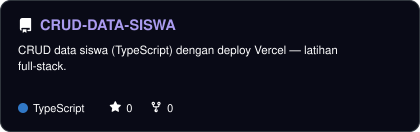
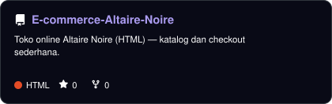
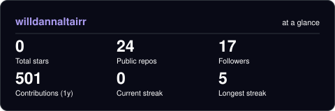

<picture>
  <source media="(prefers-color-scheme: dark)"  srcset="assets/banner-dark.v9.svg">
  <source media="(prefers-color-scheme: light)" srcset="assets/banner-light.v9.svg">
  
</picture>

 

<!-- NAME / TAGLINE - animated typing -->

 

---

 

 

---

## signals 

<table>
<tr>
<td width="50%" align="center" valign="middle">
<!-- Self-rated skills, drawn as an orb web with a spider on the hub.
     Edit assets/skills.json and the Charts workflow respins the silk. -->
<picture>
  <source media="(prefers-color-scheme: dark)"  srcset="assets/radar-dark.svg">
  <source media="(prefers-color-scheme: light)" srcset="assets/radar-light.svg">
  
</picture>

</td>
<td width="50%" align="center" valign="middle">

<!-- Hand-authored contract & language stack, same orb-web treatment.
     Edit assets/langmix.json and the Charts workflow respins the silk. -->
<picture>
  <source media="(prefers-color-scheme: dark)"  srcset="assets/radar-langs-dark.svg">
  <source media="(prefers-color-scheme: light)" srcset="assets/radar-langs-light.svg">
  
</picture>

</td>
</tr>
</table>

---

## featured projects

<!-- Cards generated by scripts/cards.py from assets/projects.json.
     Stars, forks and language are pulled live from the API on every run. -->
<table>
<tr>
<td width="50%">
  <a href="https://github.com/willdannaltairr/Blog-App">
    <picture>
      <source media="(prefers-color-scheme: dark)"  srcset="assets/card-Blog-App-dark.svg">
      <source media="(prefers-color-scheme: light)" srcset="assets/card-Blog-App-light.svg">
      
    </picture>
  </a>
</td>
<td width="50%">
  <a href="https://github.com/willdannaltairr/Blog-App-Backend">
    <picture>
      <source media="(prefers-color-scheme: dark)"  srcset="assets/card-Blog-App-Backend-dark.svg">
      <source media="(prefers-color-scheme: light)" srcset="assets/card-Blog-App-Backend-light.svg">
      
    </picture>
  </a>
</td>
</tr>
<tr>
<td width="50%">
  <a href="https://github.com/willdannaltairr/CRUD-DATA-SISWA">
    <picture>
      <source media="(prefers-color-scheme: dark)"  srcset="assets/card-CRUD-DATA-SISWA-dark.svg">
      <source media="(prefers-color-scheme: light)" srcset="assets/card-CRUD-DATA-SISWA-light.svg">
      
    </picture>
  </a>
</td>
<td width="50%">
  <a href="https://github.com/willdannaltairr/E-commerce-Altaire-Noire">
    <picture>
      <source media="(prefers-color-scheme: dark)"  srcset="assets/card-E-commerce-Altaire-Noire-dark.svg">
      <source media="(prefers-color-scheme: light)" srcset="assets/card-E-commerce-Altaire-Noire-light.svg">
      
    </picture>
  </a>
</td>
</tr>
</table>

---

## Numbers matter? ohhh yes. 

<!-- Generated by scripts/cards.py into this repo. Deliberately NOT
     github-readme-stats / streak-stats / github-profile-trophy: those are
     shared public instances that go down and take the whole section with them. -->
<picture>
  <source media="(prefers-color-scheme: dark)"  srcset="assets/card-stats-dark.svg">
  <source media="(prefers-color-scheme: light)" srcset="assets/card-stats-light.svg">
  
</picture>

 

---

---

 

<!-- galaga -->
<picture>
  <source media="(prefers-color-scheme: dark)" srcset="https://raw.githubusercontent.com/willdannaltairr/willdannaltairr/output/galaga-contribution-graph-dark.svg">
  <source media="(prefers-color-scheme: light)" srcset="https://raw.githubusercontent.com/willdannaltairr/willdannaltairr/output/galaga-contribution-graph.svg">
  
</picture>

---

` Build with love · @willdannaltairr `

